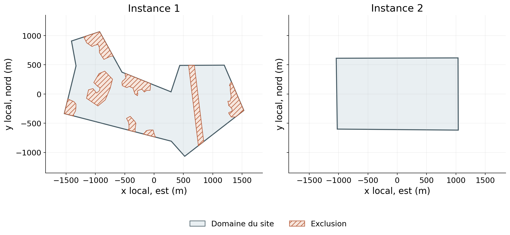
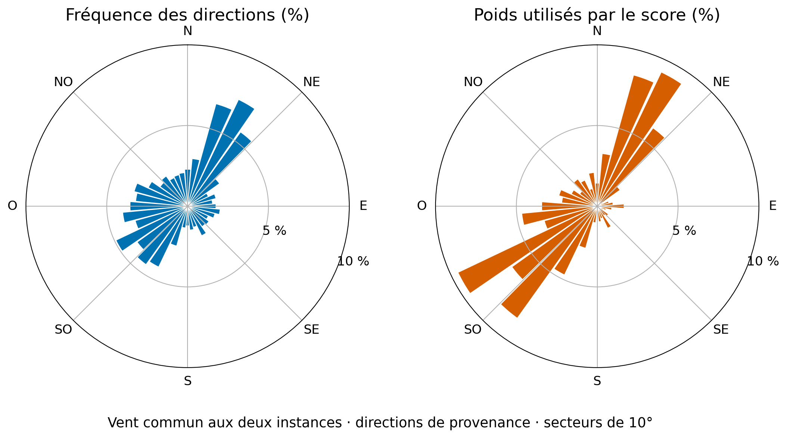
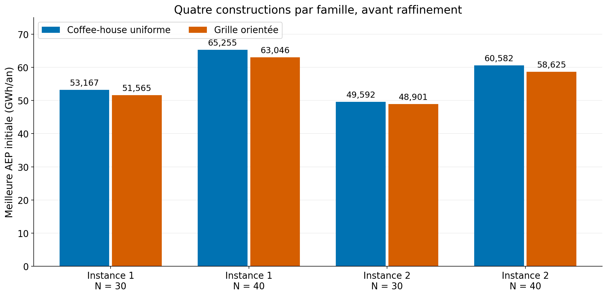
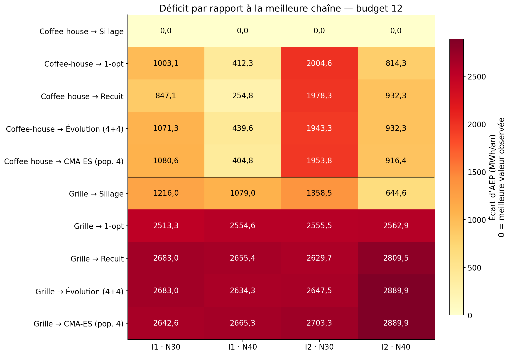
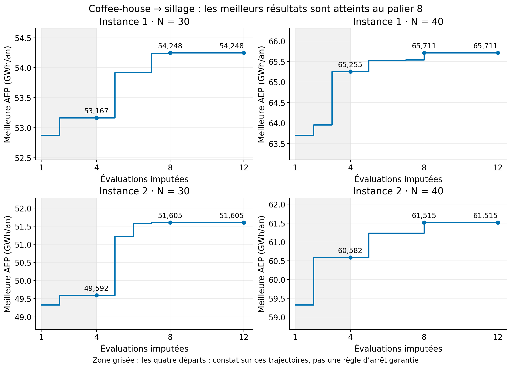
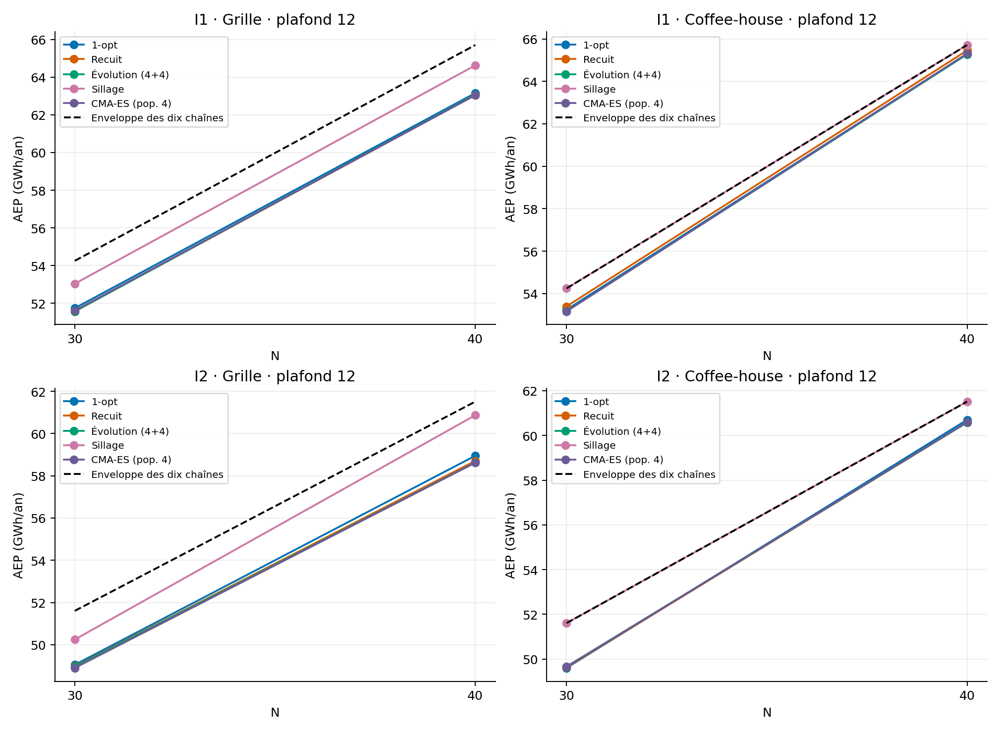
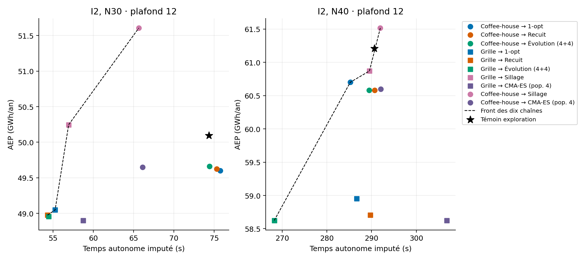

# Wind farm layout optimization with AMON

**Where should we place wind turbines to produce more energy with a small number of simulator calls?** We also compare different numbers of turbines and look at the time needed to find a good layout.

We use AMON and PyWake to measure annual energy production (AEP). Our code builds valid layouts, improves them with several search methods, and saves the results as CSV files and plots.

## The problem

For a fixed site and a fixed number of turbines $N$, a layout contains $2N$ coordinates:

$$
X=(p_1,\ldots,p_N),\qquad p_i=(x_i,y_i).
$$

We want to solve

$$
\max_X \mathrm{AEP}(X)
\quad\text{subject to}\quad
p_i\in\Omega,\qquad
\|p_i-p_j\|\geq 2D\quad(i\neq j).
$$

Here, $\Omega$ is the part of the site where turbines are allowed. It excludes the forbidden areas. $D$ is the rotor diameter. In our main experiments, $D=80$ m, so the minimum distance is 160 m. Coordinates are in metres and AEP is in GWh/year.

Before each simulation, we check that a layout has exactly $2N$ finite coordinates and satisfies the site and spacing constraints. The search returns the best valid layout it has found within its budget. It does not prove that this layout is the global optimum.

### Two sites, the same wind and turbine

The main comparison uses instances 1 and 2. They have different terrain shapes, but share the same wind data and V80 turbine model, with an 80 m rotor and a 67 m hub height. This lets us compare the effect of the terrain without changing the energy model.



The wind still matters when it is the same on both sites. A turbine can reduce the wind received by another turbine downstream. Moving the turbines changes these wake interactions. We use both wind direction and the turbine power curve to build the weights of our wake score.



The left plot counts wind observations in each direction. The right plot weights them by the power associated with their wind speed. These weights help guide the search; they are not a second calculation of the farm's AEP.

## How we build and improve a layout

### 1. Build a starting layout

Both main construction methods use the same **maximin** rule. We choose a first point at random. We then add the candidate whose distance to the nearest selected point is largest, while keeping the spacing constraint.

| Construction | Candidate points | What it controls |
|---|---|---|
| Coffee-house | Uniform random points, filtered by the terrain | Spreads the turbines over the available area |
| Oriented grid | Regular points, rotated and filtered by the terrain | Tests the effect of the grid angle and spacing |

The main comparison uses 5,000 raw candidates for Coffee-house. The grid has spacings of 320 and 161 m, with angles of 30°, 75°, 120° and 165°. The 161 m spacing leaves a small margin above the 160 m constraint. The angle rotates the positions, not the turbine rotors.

Maximin is a geometric rule. It gives us valid, well-spread starts, but it does not directly maximize energy.

### 2. Improve the starts

We apply each of the five methods below to **both** construction families.

| Method | How it proposes a change | What it keeps |
|---|---|---|
| 1-opt | Moves one turbine along one coordinate axis | The move if AEP increases |
| Simulated annealing | Moves one turbine and sometimes accepts a lower AEP | A current layout and a separate best layout |
| Evolution strategy $(4+4)$ | Mutates one turbine in a selected parent layout | The four best layouts among parents and children |
| Wake-guided exchanges | Replaces a turbine position to reduce a cheap wake score | Low-score candidates, then the best measured AEP |
| CMA-ES | Adapts a Gaussian distribution over the $2N$ coordinates | Proposals ranked by AEP and constraint penalties |

For annealing, we define $\Delta=\mathrm{AEP}_{\rm proposed}-\mathrm{AEP}_{\rm current}$. A lower-AEP proposal is accepted with probability $\exp(\Delta/T)$. Better proposals are accepted. The temperature $T$ decreases and has the same energy unit as $\Delta$. The best AEP seen so far is kept even when the current layout gets worse.

The initial temperature is $0.10/\ln(2)$ GWh: a loss of 0.10 GWh then has a one-half acceptance probability. Over the eight new evaluations, the temperature is reduced by a factor of 20. These settings were fixed before the comparison.

The evolution strategy uses four parents and four children. The “plus” means that parents can survive the selection. Mutations act on one turbine, with two independent Gaussian components. Their standard deviation is $D/\sqrt{2}$, then $D/(2\sqrt{2})$ after four new AEP evaluations in the 12-evaluation experiment. This is a random displacement, not a fixed movement of length $D$.

CMA-ES uses the `cma` library with a population of four and an initial scale of 5 m. Invalid proposals receive a penalty without running PyWake. For this reason, eight simulator calls do not always mean two CMA-ES generations.

### The wake score

For a pair of turbines and a wind sector, we project their separation along and across the wind. We call these distances $s$ and $t$. The score adds weighted terms of the form

$$
w\exp\left[-\frac12\left(\frac{t}{\sigma_0+\kappa|s|}\right)^2-\frac{|s|}{L}\right],
\qquad \sigma_0=D/2,\quad\kappa=0.05,\quad L=10D.
$$

The code sets the term to zero when $|s|\leq10^{-9}$ m. The weights $w$ come from the wind observations and power curve. Lower scores suggest less wake interaction. These parameters are fixed heuristic choices; they are not fitted to the AEP values in the comparison.

The score is cheap enough to examine many changes before asking AMON to evaluate a layout. In the main comparison, each wake-guided branch runs eight descents of 240 internal proposals. Each descent starts from the best of the four initial layouts and uses a different seed. Only its final layout is sent to AMON.

This proxy gives the same pair score for opposite wind directions. It is simpler than the actual wake model. A lower score can still give a lower AEP, so the final choice always uses AMON's AEP.

The Gaussian crosswind profile and linear wake expansion used in our heuristic wake score are based on ideas described by Bastankhah and Porté-Agel (2014), [*A new analytical model for wind-turbine wakes*](https://www.sciencedirect.com/science/article/abs/pii/S0960148114000317). The exponential decay with downstream distance is a separate heuristic choice in this project.

## Comparison at the same evaluation budget

We compare the two construction families and five refinements on instances 1 and 2, with 30 and 40 turbines. This gives 40 search branches.

Each branch has a budget of **12 AEP evaluations: four starting layouts and eight further evaluations**. We report the best valid AEP at budgets 4, 8 and 12. The four starts are shared within a construction family, but their cost is counted for every branch that uses them.

We distinguish simulator calls from internal proposals. An invalid geometric proposal does not call PyWake. A reused AEP counts towards a method's comparison budget, but it is not a new physical call.

### Starting layouts

Best AEP among the four starts, in GWh/year:

| Instance | Turbines | Coffee-house | Oriented grid |
|---|---:|---:|---:|
| 1 | 30 | 53.167 | 51.565 |
| 1 | 40 | 65.255 | 63.046 |
| 2 | 30 | 49.592 | 48.901 |
| 2 | 40 | 60.582 | 58.625 |



### Results after refinement

Coffee-house followed by wake-guided exchanges gives the highest AEP in all four contexts at budget 12. The wake-guided method also gives the best result within each grid family.

| Instance | Turbines | Best AEP (GWh/year) | Gain over the best start | Accounted time (s) |
|---|---:|---:|---:|---:|
| 1 | 30 | **54.247551** | +1.080579 | 66.117 |
| 1 | 40 | **65.711479** | +0.456505 | 295.766 |
| 2 | 30 | **51.604816** | +2.013266 | 65.641 |
| 2 | 40 | **61.514767** | +0.932343 | 291.953 |

The plot below compares all ten combinations. It shows the AEP lost relative to the best branch in each context, in MWh/year. Zero is best. Differences are calculated before rounding.



These four best values were already reached by budget 8. The next four evaluations did not improve them in these runs. This is an observation about these trajectories, not a rule that future searches can always stop at eight.



We also compared refinement with spending all 12 evaluations on new Coffee-house layouts. Wake-guided refinement improved on this exploration baseline by 1.080579, 0.456505, 1.510123 and 0.307914 GWh/year, respectively for I1/N30, I1/N40, I2/N30 and I2/N40.

The recorded extension used 240 new PyWake calls because compatible results from earlier runs were reused. It took 57 min 3 s before plotting and analysis, including 56 min 41 s of simulation. Peak memory for the common process was 313.3 MiB. A complete run from an empty output folder has a different call count; see the commands below.

## More turbines, more energy, more work

We optimized the 30-turbine and 40-turbine layouts separately. For a fixed method and site, the average gain between these sizes is

$$
g_{30\to40}=\frac{\mathrm{AEP}_{40}-\mathrm{AEP}_{30}}{40-30}.
$$

For Coffee-house followed by wake-guided exchanges, this is **1.146393 GWh/year per extra turbine** on instance 1 and **0.990995** on instance 2. This difference compares two optimized farms; it is not the output of each individual turbine added to the same farm.



The choice also depends on what we need:

| Goal | Choice supported by our measurements |
|---|---|
| Highest AEP at fixed site, turbine count and budget 12 | Coffee-house followed by wake-guided exchanges, in the four tested contexts |
| At least 60 GWh/year with few turbines | 40 is the smallest tested count reaching this target in the experiments we compared |
| Reach that 60 GWh/year target with few simulator calls | At 40 turbines, the four Coffee-house starts already reach it on both sites |
| Trade energy against search time | Compare the measured AEP–time front at the same site, turbine count and evaluation budget |

At instance 2 with 40 turbines, 1-opt after Coffee-house gives 60.700465 GWh/year in 285.238 s. Wake-guided exchanges after the grid give 60.870137 in 289.524 s. The same refinement after Coffee-house gives 61.514767 in 291.953 s.



The accounted time includes construction, validation, search work and the simulation time assigned to the branch. It excludes common site preparation. Reused evaluations keep their original times. Small differences measured in separate runs do not prove that one method is always faster.

To choose a turbine count for a target $Q$, we can minimize $N$ among the measured layouts satisfying $\mathrm{AEP}\geq Q$ and a chosen evaluation budget. Turbine count is not a price: a decision in euros would need explicit turbine costs and an electricity value. We do not invent these inputs.

We also compute the choices that maximize $E-\lambda N$ for $\lambda\geq0$, separately for each site and evaluation budget. Here $E$ is AEP and $\lambda$ is an energy penalty per turbine, in GWh/year per turbine. The threshold values tell us when the preferred measured farm changes. If an annual cost per turbine $c_a$ in €/year and electricity value $p>0$ in €/MWh are supplied, then $\lambda=c_a/(1000p)$; the factor 1000 converts GWh to MWh. No monetary values are assumed by default.

## Install and run

We used Python 3.12. The package versions are listed in `requirements.txt`. From the repository root:

```bash
python -m venv .venv
```

Activate the environment:

```powershell
# Windows PowerShell
.\.venv\Scripts\Activate.ps1
```

```bash
# Linux or macOS
source .venv/bin/activate
```

Then install the dependencies and read the command help:

```bash
python -m pip install -r requirements.txt
python main.py --help
```

AMON, its terrain files, wind data and turbine power curves are included. The program does not need a previous output folder. All commands below are run from the repository root.

Running `python main.py` without arguments only shows the help. Choose a command to start work.

### Build a small layout

Build and validate five turbines without a simulator call:

```bash
python main.py placer --instance 1 --eoliennes 5 --methode grille --sans-aep --sortie resultats/demo_geometry
```

Build the layout and measure its AEP with one PyWake call:

```bash
python main.py placer --instance 1 --eoliennes 5 --methode grille --sortie resultats/demo_energy
```

`--eoliennes` is the number of turbines in each layout. `--nombre` is the number of layouts to build for each angle. The construction choices are `aleatoire`, `coffee_house`, `grille`, `quinconce`, `graphe` and `sobol`.

### Compare construction and refinement

A single site and turbine count, starting from Coffee-house, with all five refinements: at most 44 calls before any exact sharing.

```bash
python main.py comparer --instances 1 --effectifs 30 --familles coffee_house --methodes 1opt recuit evolution sillage cmaes --budget 12 --sortie resultats/comparison_small
```

The full 30/40 comparison starts from an empty folder and builds its own initial layouts:

```bash
python main.py comparer --instances 1 2 --effectifs 30 40 --familles coffee_house grille --methodes 1opt recuit evolution sillage cmaes --budget 12 --temoin --sortie resultats/comparison
```

This requests at most **384 PyWake calls**, including the extra Coffee-house exploration baseline. Without `--temoin`, the ceiling is **352 calls**. The 12-evaluation budget is per method and includes initialization; it is not the total number of calls in the full comparison.

The default seed is `20261113`. The starts and method seeds follow the recorded protocol. Use `--graine` to explore a different trajectory. The run saves its settings, results and coordinates. Runtime depends on the machine and the number of turbines.

After cleaning the code, we checked the search paths by replaying recorded AEP values for the exact same proposed layouts. The 40 branches and their budget summaries matched the completed experiments. This check did not rerun PyWake or remeasure the times.

### Plot and choose a layout from a run

These commands read generated results and do not call PyWake:

```bash
python main.py tracer --campagne resultats/comparison
python main.py decision --csv resultats/comparison/comparaison.csv --cible 60 --sortie resultats/decision
```

The decision command writes the observed front, choices under the target, gains between turbine counts, and the symbolic trade-off thresholds in `seuils.csv`. `egalites.csv` records the ties at the exact thresholds.

### Check prediction models

The kriging command compares prediction models from a supplied CSV, without simulation:

```bash
python main.py krigeage --csv grid_data.csv --sortie resultats/kriging
```

The CSV must describe a single site and turbine count and contain:

| Column | Meaning |
|---|---|
| `angle_deg` | Grid rotation in degrees |
| `tau` | Global x translation divided by the grid x-spacing in data exported by `placer` |
| `score_R` | Dimensionless wake score |
| `aep_gwh` | Measured annual energy in GWh |
| `parc_id` | Identifier of the layout geometry, shared by duplicate layouts |

The score `R` is not the R programming language. Models are fitted on the training layouts of each fold, with an entire angle kept out for prediction. This command needs AEP measurements as input; it does not generate training data for free.

The grid inputs are scaled as `angle_deg / 180` and `(tau + 0.25) / 0.5`. The Matérn 5/2 kernel keeps a fixed length scale of 0.25 and a diagonal regularization of `1e-8`; these values are not tuned using the held-out angles. The models compare a Gaussian process, an affine fit on the score, and kriging with either a score-based or constant drift.

For example, this builds a small grid dataset with up to eight PyWake calls, then checks the prediction models:

```bash
python main.py placer --instance 1 --eoliennes 30 --methode grille --angles 0 15 30 45 60 75 90 105 --graine 42 --nombre 1 --sortie resultats/grid_sample
python main.py krigeage --csv resultats/grid_sample/grilles.csv --sortie resultats/kriging_sample
```

Keep the site, turbine count, spacing and selection seed fixed when using angle and translation as the GP inputs. Changing the seed can produce different layouts at the same input values. This example varies only the angle, with zero translation; it does not test prediction across translations. Use one consistent translation convention within a dataset.

Several angles and distinct layouts are needed for this check. A single demo layout is not enough to fit and compare the models. This small example checks the workflow; it is not the historical validation on 33 layouts.

## Code and output files

`main.py` reads the command line. The numerical methods are in `placement_eoliennes/src/`, and `placement_eoliennes/experiences/` connects them to AMON and writes the outputs. `AMON-main/` contains the simulator and physical input data. `figures/` contains the fixed images used above.

The source also keeps the other methods studied in the project, including random construction, staggered grids, conflict graphs, Sobol candidate clouds, greedy construction, Gaussian-process expected improvement, graph-based prediction and reduced-wind evaluation. These modules remain available through Python. Their presence does not mean that they all took part in the ten-branch comparison above.

Each run writes under the output path selected by `--sortie`. The main comparison saves its plan, per-call records, best-AEP comparisons, turbine coordinates and plots. Git ignores generated results, local environments and caches. No old AEP cache is needed to start a new comparison.

## What we learned

Good geometric starts already produce useful layouts. At the small budgets tested here, using a cheap wake score to guide many proposals before calling AMON was the most effective refinement. It also beat the choice of spending the same evaluation budget on more Coffee-house constructions.

This does not make annealing, evolution or CMA-ES bad methods. We tested particular settings and short trajectories. The two main sites share a wind dataset, and we did not establish a general ranking over all terrains, wind conditions or random seeds. The useful result is a measured choice for this setting, with clear costs and steps that we can explain.

## Credits

[AMON](https://github.com/josephinegobert/AMON) and its physical data were provided for the course and are included with the prof's permission. PyWake computes the wind farm energy. CMA-ES uses the separate `cma` library; we do not claim to have implemented its internal solver.

This project was developed as part of the *Advanced Optimization* course taught by [Régis Duvigneau](https://cv.hal.science/regis-duvigneau) and [Mickaël Binois](https://sites.google.com/site/mickaelbinoishomepage/) at Université Côte d’Azur (MAM5 / Master 2 IM-INUM).

This project was developed in collaboration with Akhmed Moutaliev (@tamad01).

